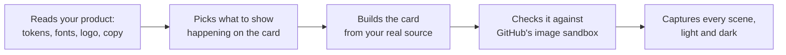

<a href="https://chanmeng666.github.io/chanmeng-svg-animation-studio/"></a>

**An agent skill that turns your project into an animated promo card for your README.** Not a GIF and not a screen recording: one SVG file where your product's real interface runs, sharp at any width.

<p>
<a href="https://chanmeng666.github.io/chanmeng-svg-animation-studio/"></a> <a href="#install"></a>
</p>

## Cards it makes

Each of these is live on [a real GitHub profile](https://github.com/ChanMeng666), made with the method and kit this skill ships.

<a href="https://github.com/ChanMeng666/archlang"></a>

<a href="https://github.com/ChanMeng666/echook"></a>

<a href="https://github.com/ChanMeng666/a11y-loop"></a>

## Install

**Any agent** (Claude Code, Cursor, Codex, GitHub Copilot and more), with the skills CLI. Listed on [skills.sh](https://skills.sh/chanmeng666):

```bash
npx skills add ChanMeng666/chanmeng-svg-animation-studio
```

**Claude Code plugin:**

```
/plugin marketplace add ChanMeng666/chanmeng-svg-animation-studio
/plugin install chanmeng-svg-animation-studio@chanmeng-svg-animation-studio
```

Then, in your project:

```
Make an animated README card for this repo.
```

Using another coding agent? Point it at [`SKILL.md`](./skills/chanmeng-svg-product-card/SKILL.md): the kit is plain Node.

## What the skill does



The builder is committed beside the card, so it rebuilds without the skill, and it fails when your product stops matching the picture.

More: [the field guide](./skills/chanmeng-svg-product-card/references/field-guide.md) · [the rest of the studio](./docs/overview.md), including the library behind mascots, logos and loaders.

---

<p>
<a href="https://github.com/ChanMeng666"></a>
</p>

<sub>[MIT](./LICENSE). Made by Chan Meng. Need a custom build? <a href="mailto:chanmeng.dev@gmail.com">chanmeng.dev@gmail.com</a>.</sub>
